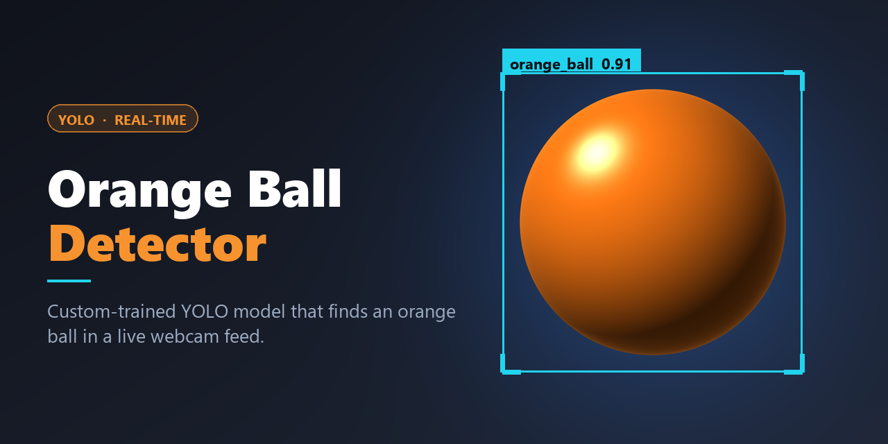

# Orange Ball Detector



A custom-trained [YOLO](https://docs.ultralytics.com/) model that detects an orange ball in a live webcam feed and draws a bounding box around it in real time.

## Quick start

```bash
# 1. Create and activate a virtual environment
python -m venv .venv
.venv\Scripts\activate          # Windows
# source .venv/bin/activate     # macOS / Linux

# 2. Install dependencies
pip install -r requirements.txt

# 3. Run the live webcam detector (press 'q' to quit)
python src/track_orange_ball.py
```

No webcam? Point the model at any image file instead:

```bash
python src/detect_image.py photo.jpg
python src/detect_image.py photo.jpg --conf 0.4
```

Annotated copies are written to `examples/`.

## Project layout

```
orange-ball-tracker/
├── assets/
│   └── thumbnail.png             Project banner
├── models/
│   └── mazen.pt                  Trained YOLO weights (1 class: orange_ball)
├── src/
│   ├── track_orange_ball.py      Live webcam detection
│   └── detect_image.py           Run the model on image files
├── requirements.txt
└── README.md
```

## How it works

`models/mazen.pt` is a single-class YOLO detection model (`0: orange_ball`). `track_orange_ball.py` opens the default camera at 1280x720, runs `model.predict()` on every frame, and displays the annotated frame with OpenCV.

## Tuning the confidence threshold

`CONFIDENCE` in `track_orange_ball.py` controls how sure the model must be before a box is drawn:

- **Too high** (0.9+) — the model rarely scores that high, so almost nothing is drawn and it looks broken.
- **Too low** (below ~0.3) — boxes appear on random background objects.

0.5 is the default. Adjust from there based on your lighting.

## Known limitations

The model was trained on a small dataset and it is **shape-driven, not colour-driven**. It reliably finds an actual orange ball (~0.91 confidence) and correctly returns nothing on an empty background, but in testing it also fired confidently on:

- a *blue* ball (0.83 confidence)
- a plain skin-toned oval (0.94 confidence)

So treat a detection as "there is a round object here" rather than "there is an orange ball here".

To improve it, retrain with more varied images and, importantly, **hard negatives** — balls in other colours and other round objects, labelled as background.

## Requirements

Python 3.10+ and the packages in `requirements.txt` (Ultralytics, PyTorch, OpenCV). A GPU is optional; the model runs fine on CPU.
